# MediCore
### Hospital & Clinic Management System

**A unified digital platform for healthcare administration, patient management, clinical workflows, laboratory operations, and financial administration.**

<p align="center">
  
  
  
  
  
  
</p>

<p align="center">
  <a href="https://medicore-snowy.vercel.app">Live Application</a> ·
  <a href="https://github.com/ASAD1960/MediCore">GitHub Repository</a>
</p>

---

# 1. Project Overview

MediCore is a web-based Hospital and Clinic Management System designed to centralize essential healthcare administration and operational workflows.

It provides a structured digital environment for managing patients, doctors, appointments, consultations, prescriptions, laboratory operations, billing, and organizational activities.

The platform follows a modular backend architecture with a separately developed React frontend and PostgreSQL database.

### Primary objectives

- Centralize healthcare administrative operations.
- Organize patient and doctor records.
- Improve appointment scheduling and coordination.
- Support structured consultation and prescription workflows.
- Manage laboratory orders, samples, and results.
- Maintain billing and payment records.
- Enforce role-based access control.
- Support organization-level data isolation.
- Provide a foundation for future healthcare SaaS development.

# 2. Live Application

| Resource | Link |
|---|---|
| Production application | https://medicore-snowy.vercel.app |
| GitHub repository | https://github.com/ASAD1960/MediCore |
| Production branch | `main` |
| Hosting platform | Vercel |

MediCore is deployed using Vercel's multi-service configuration, with separate frontend and backend services.

The frontend uses a single-page application architecture. Client-side routes such as `/doctors` and `/patients` are handled through an `index.html` fallback.

API requests are routed separately to the backend service through `/api`.

# 3. Technology Stack

## Frontend

- React 18
- TypeScript
- Vite
- React Router
- Zustand
- TanStack Query
- Tailwind CSS
- Zod
- Recharts

## Backend

- Node.js
- Express.js
- TypeScript
- Prisma ORM
- PostgreSQL
- JWT authentication
- Argon2 password hashing
- Zod validation

## Infrastructure and tooling

- Git and GitHub
- Vercel
- Managed PostgreSQL
- npm
- Vitest
- Supertest

# 4. System Architecture

MediCore follows a modular monolithic backend architecture with a separately developed frontend.

The frontend provides the user interface, the backend handles authentication and business logic, and PostgreSQL stores application data.

## 4.1 High-level architecture

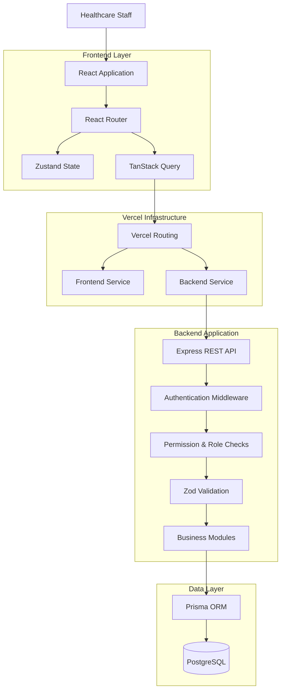

## 4.2 Architecture responsibilities

| Layer | Responsibility |
|---|---|
| Presentation | User interface and application navigation |
| State management | Client-side application state |
| Data fetching | API requests, caching, and synchronization |
| Routing | Frontend and backend request distribution |
| API | HTTP endpoints and request handling |
| Authentication | Identity and session verification |
| Authorization | Role and permission enforcement |
| Validation | Input and business-rule validation |
| Business logic | Healthcare operational workflows |
| ORM | Database queries and transactions |
| Database | Persistent organizational and clinical records |

# 5. Complete System Working Flow

This section explains how the different parts of MediCore work together during normal operation.

## 5.1 Overall operational workflow

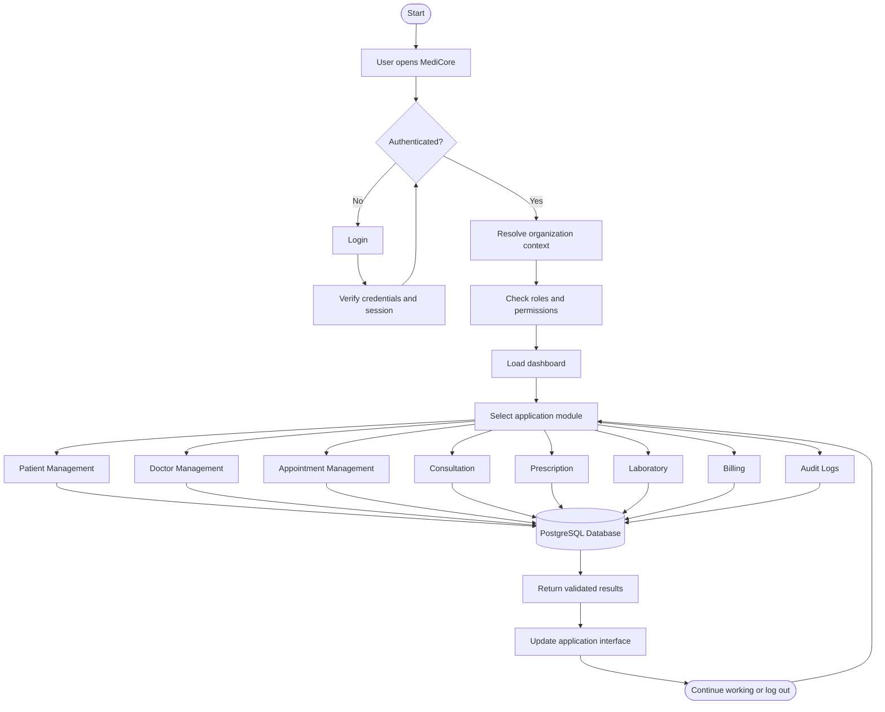

The diagram represents the overall application workflow. Each operation is subject to its own authorization, validation, and business rules.

## 5.2 User authentication and access flow

1. A user opens the application.
2. The authentication interface collects login credentials.
3. The backend validates the credentials.
4. Password verification uses the configured password-hashing mechanism.
5. A successful login establishes the authentication session.
6. The backend resolves the user's organization and authorization context.
7. Protected endpoints check authentication and permissions.
8. The frontend displays the accessible application functionality.

### Authentication sequence

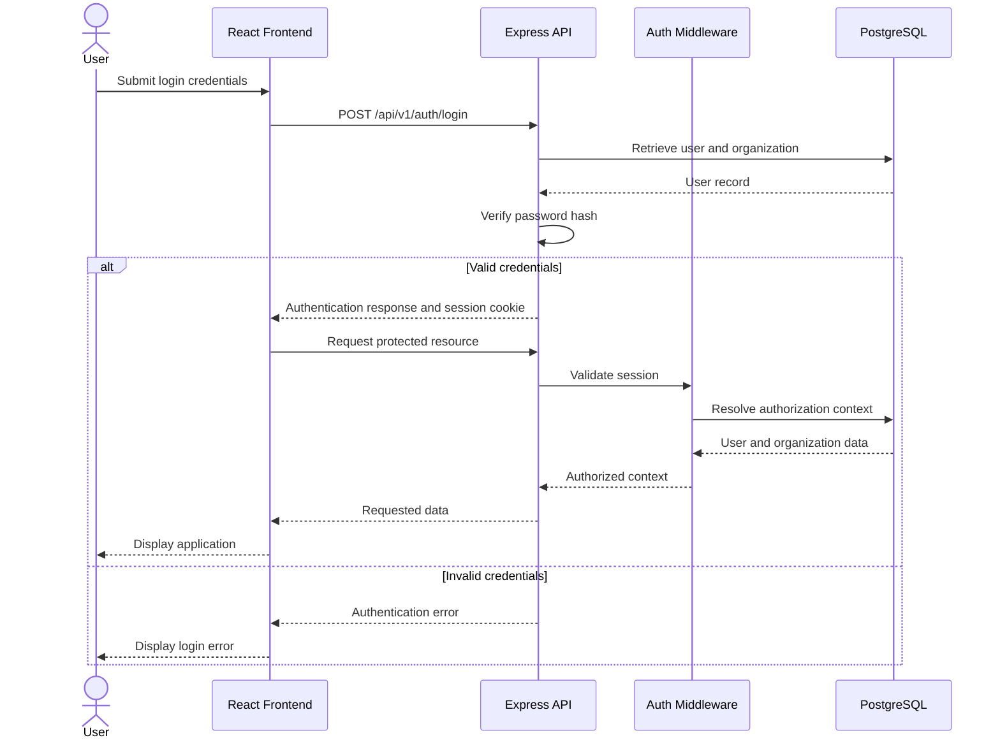

## 5.3 Patient management workflow

Patient management is the foundation for many healthcare workflows.

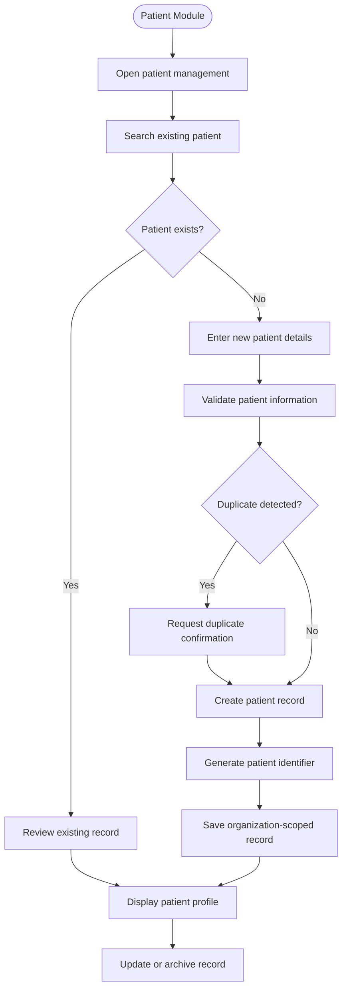

Patient management functionality includes:

- Patient registration.
- Patient retrieval.
- Patient record updates.
- Patient archiving.
- Search and pagination.
- Duplicate detection.
- Organization-scoped records.
- Automatically generated patient identifiers.

Example identifier: `PAT-00001`.

## 5.4 Appointment scheduling workflow

Appointment management coordinates patients, doctors, schedules, and appointment statuses.

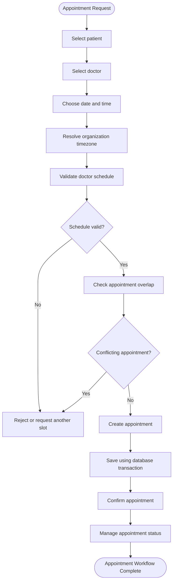

Implemented scheduling safeguards include:

- Doctor schedule validation.
- Slot-duration validation.
- Appointment overlap checks.
- Organization timezone handling.
- Protection against conflicting schedule changes.
- Transaction-based appointment creation.

Appointment blocking statuses include:

- `SCHEDULED`
- `CONFIRMED`
- `CHECKED_IN`
- `WAITING`
- `IN_CONSULTATION`

## 5.5 Consultation workflow

A consultation connects an appointment and patient record to the clinical encounter.

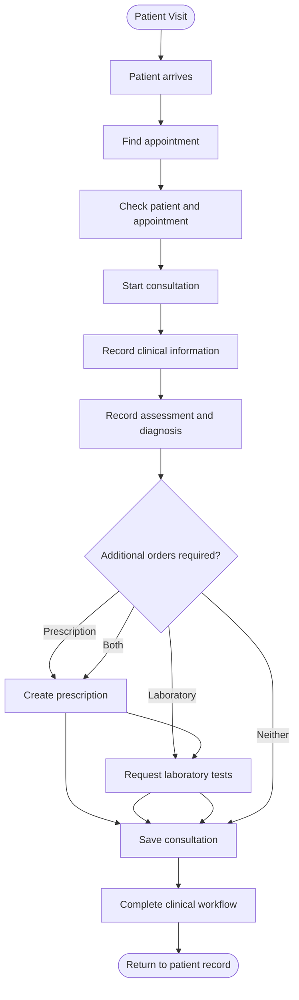

The consultation workflow is intended to organize clinical documentation and connect the encounter with associated operational records.

Clinical decisions must remain the responsibility of qualified healthcare professionals.

## 5.6 Prescription workflow

The prescription module provides a structured way to manage medication instructions associated with clinical encounters.

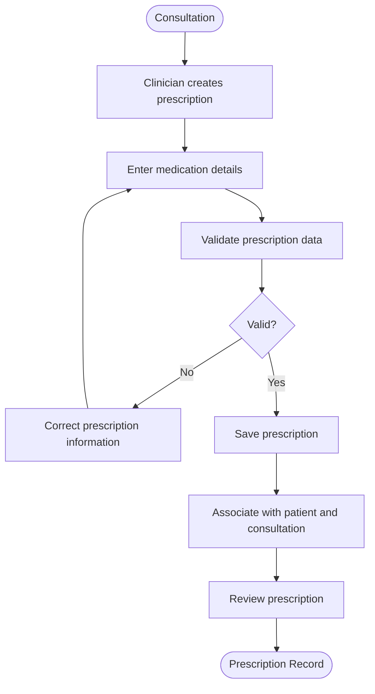

Prescription records can include medication-related information and instructions defined by the application's data model.

Medication administration, pharmacy dispensing, and clinical decision support should not be assumed to be implemented solely because prescription records exist.

## 5.7 Laboratory workflow

The laboratory module organizes test requests and the progression of laboratory orders.

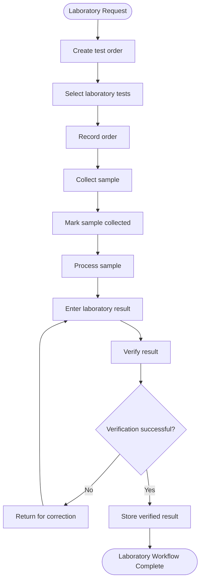

Supported laboratory lifecycle:

`REQUESTED → SAMPLE_COLLECTED → PROCESSING → RESULT_ENTERED → VERIFIED`

Laboratory capabilities include:

- Test catalogs.
- Test definitions and pricing.
- Laboratory orders.
- Sample collection.
- Processing status.
- Result entry.
- Result verification.

## 5.8 Billing workflow

Billing manages financial records associated with healthcare services.

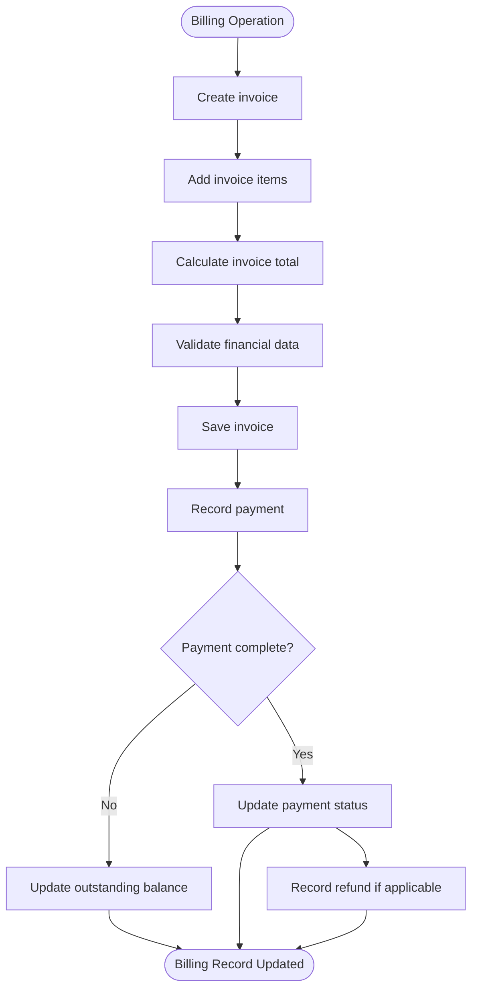

The billing module includes invoice and payment-related application functionality. Accounting reconciliation, payment gateway integration, and tax compliance require separate verification.

# 6. Application Modules and Responsibilities

| Module | Primary responsibilities |
|---|---|
| Authentication | Login, logout, and session authentication |
| Dashboard | Operational overview |
| Patients | Registration, records, search, and archiving |
| Doctors | Doctor records and scheduling |
| Appointments | Scheduling and status management |
| Consultations | Clinical encounter workflows |
| Prescriptions | Prescription records |
| Laboratory | Test catalogs, orders, samples, and results |
| Billing | Invoices and payment records |
| Audit Logs | Visibility into selected operational activities |

## Dashboard

The dashboard provides an organizational overview of operational information.

Its purpose is to give authorized users a centralized starting point for navigating healthcare activities.

## Patients

Manages patient registration, retrieval, updates, search, duplicate detection, and archiving.

## Doctors

Manages doctor records and scheduling-related functionality.

## Appointments

Handles appointment creation, scheduling validation, conflict prevention, and status management.

## Consultations

Provides the application structure for documenting clinical encounters.

## Prescriptions

Maintains prescription records associated with clinical workflows.

## Laboratory

Organizes test catalogs, laboratory orders, samples, and results.

## Billing

Maintains invoice and payment-related records.

## Audit Logs

Provides visibility into selected application activities.

# 7. Data Flow and Database Architecture

MediCore uses PostgreSQL with Prisma ORM.

The backend validates requests, applies business rules, and accesses the database through Prisma.

### Database interaction flow

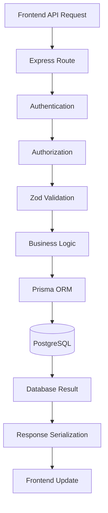

The database schema includes concepts such as:

- Organizations and branches.
- Users and employees.
- Patients and doctors.
- Appointments and schedules.
- Consultations and encounters.
- Diagnoses and allergies.
- Prescriptions and medicines.
- Laboratory tests, orders, and results.
- Invoices and payments.
- Audit records.
- Admissions, wards, and beds.
- Notifications and file attachments.

The existence of a database model does not necessarily mean its complete user interface or operational workflow is implemented.

# 8. Multi-Tenant Architecture and Security

MediCore is designed to support multiple healthcare organizations within a shared application architecture.

Organization-owned records are scoped using organization identifiers.

Security-related implementation includes:

- Password hashing with Argon2.
- JWT-based authentication.
- HTTP-only authentication cookies.
- Authentication middleware.
- Role-based and permission-based authorization.
- API rate limiting.
- Zod request validation.
- Organization-scoped database operations.

### Authorization workflow

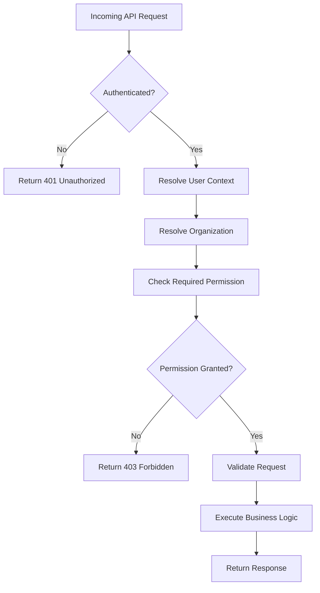

Protected backend operations must enforce authorization independently of frontend visibility.

# 9. Roles and Permissions

MediCore uses a permission-oriented authorization design.

The defined role structure includes:

- Organization Administrator.
- Receptionist.
- Doctor.
- Accountant.

Permission domains include:

- `patients.*`
- `doctors.*`
- `appointments.*`
- `consultations.*`
- `prescriptions.*`
- `billing.*`
- `reports.view`
- `users.manage`
- `audit.view`

The exact permissions assigned to each role should be verified against the current seed and authorization configuration.

# 10. Project Structure

```text
MediCore/
│
├── medicore-backend/
│   ├── prisma/
│   │   ├── schema.prisma
│   │   ├── migrations/
│   │   └── seed.ts
│   │
│   ├── src/
│   │   ├── app.ts
│   │   ├── modules/
│   │   ├── middleware/
│   │   ├── services/
│   │   ├── utils/
│   │   └── ...
│   │
│   ├── package.json
│   └── tsconfig.json
│
├── medicore-frontend/
│   ├── public/
│   │   └── favicon.svg
│   │
│   ├── src/
│   │   ├── components/
│   │   ├── pages/
│   │   ├── services/
│   │   ├── stores/
│   │   ├── hooks/
│   │   └── ...
│   │
│   ├── index.html
│   ├── package.json
│   └── vite.config.ts
│
├── vercel.json
├── .gitignore
└── README.md
```

The structure is representative; individual module and utility files may evolve as development continues.

# 11. Local Installation and Development

## Prerequisites

- Node.js compatible with project dependencies.
- npm.
- PostgreSQL or a compatible managed PostgreSQL database.
- Git.

## Clone repository

```bash
git clone https://github.com/ASAD1960/MediCore.git
cd MediCore
```

## Backend setup

```bash
cd medicore-backend
npm install
```

Configure the backend environment variables in a local `.env` file.

Generate Prisma Client:

```bash
npx prisma generate
```

Apply development migrations:

```bash
npx prisma migrate dev
```

If appropriate for your local environment:

```bash
npm run seed
```

Start the backend:

```bash
npm run dev
```

Default local backend address:

`http://localhost:4000`

Health endpoints:

- `http://localhost:4000/health`
- `http://localhost:4000/ready`

## Frontend setup

Open a second terminal:

```bash
cd medicore-frontend
npm install
npm run dev
```

Default frontend address:

`http://localhost:5173`

## Build verification

Backend:

```bash
cd medicore-backend
npm run build
```

Frontend:

```bash
cd medicore-frontend
npm run build
```

Run backend tests:

```bash
cd medicore-backend
npm test
```

Run commands from their respective application directories. The repository root is not a single npm application.

# 12. Environment Configuration

Environment variables must be configured independently for local development and production.

## Backend configuration

| Variable | Purpose |
|---|---|
| `DATABASE_URL` | PostgreSQL connection |
| `JWT_SECRET` | Authentication token signing |
| `NODE_ENV` | Application environment |
| `PORT` | Backend server port |
| `FRONTEND_URL` | Approved frontend origin |

Use the actual variable names defined in the backend configuration.

Never commit `.env` files or production secrets.

## Frontend configuration

| Variable | Purpose |
|---|---|
| `VITE_API_URL` | Frontend API base URL |

The production frontend uses the `/api/v1` API path through the Vercel routing configuration.

# 13. Production Deployment Architecture

MediCore uses a root-level `vercel.json` to configure separate frontend and backend services.

### Deployment flow

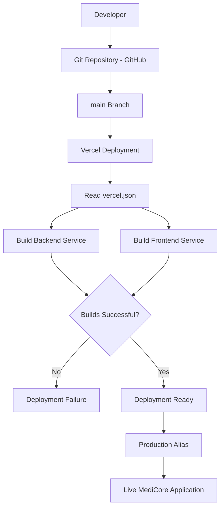

### Service configuration

| Service | Configuration |
|---|---|
| Backend | Express |
| Backend entry point | `medicore-backend/src/app.ts` |
| Frontend | Vite |
| Frontend build output | `dist` |
| Routing configuration | Root `vercel.json` |

### Request routing

| Request | Destination |
|---|---|
| `/api/*` | Backend service |
| `/doctors` | Frontend service |
| `/patients` | Frontend service |
| `/appointments` | Frontend service |
| `/consultations` | Frontend service |
| `/` | Frontend service |

The frontend service includes an SPA fallback to `/index.html`, allowing React Router to handle direct browser navigation and refreshes.

### Deployment verification

After deployment, verify:

1. Backend and frontend builds complete.
2. Deployment status becomes Ready.
3. Homepage loads.
4. Direct frontend routes return the application HTML.
5. API health and readiness endpoints respond.
6. Authentication works.
7. Protected API requests enforce permissions.

# 14. Testing and Quality Assurance

MediCore uses automated backend tests and production build verification.

Previously recorded test coverage includes:

- Appointment overlap protection.
- Appointment timezone handling.
- Dashboard date-range calculations.
- Billing workflow rules.
- Consultation workflow rules.
- Laboratory workflow rules.
- Prescription workflow rules.

The last recorded backend test execution passed 45 tests across 7 test files. This is a historical result, not a guarantee that every subsequent revision has been tested.

### Build verification

The project has successfully completed:

- Backend TypeScript production compilation.
- Prisma Client generation.
- Frontend TypeScript compilation.
- Vite production builds.
- Vercel backend and frontend builds.

### Recommended additional testing

- Authentication and session expiry.
- Role and permission boundaries.
- Cross-organization data isolation.
- Patient validation and duplicate detection.
- Appointment concurrency.
- Laboratory result integrity.
- Billing transaction integrity.
- API security.
- Frontend end-to-end workflows.

# 15. Current Limitations and Production Readiness

MediCore is an actively developed software project.

Although its main application modules and deployment infrastructure have been implemented, additional work is necessary before commercial healthcare use.

Areas requiring further review include:

- Comprehensive security assessment.
- Cross-tenant authorization testing.
- Database backup and restoration procedures.
- Complete audit coverage.
- Session and cookie security verification.
- Monitoring and incident response.
- Secure file and attachment handling.
- Healthcare regulatory and privacy compliance.
- Clinical workflow validation with qualified professionals.

MediCore should not be considered a certified electronic health record or a clinically validated medical system.

Real patient information should not be entered into an environment that has not been appropriately secured, tested, and approved.

# 16. Future Development

Potential future improvements include:

- Advanced electronic health records.
- Pharmacy and inventory management.
- Inpatient and admission workflows.
- Ward and bed management.
- Patient self-service portal.
- Notifications and reminders.
- Advanced analytics and reporting.
- Financial reporting and reconciliation.
- External healthcare integrations.
- Improved operational monitoring.
- Expanded automated and end-to-end testing.

These are planned opportunities and should not be interpreted as completed functionality.

# 17. Development Guidelines

1. Preserve the existing modular architecture.
2. Keep organization-owned data tenant-scoped.
3. Enforce backend authorization.
4. Validate incoming requests.
5. Maintain database integrity.
6. Use transactions for critical workflows.
7. Preserve timezone-aware scheduling.
8. Add tests for new business logic.
9. Verify frontend and backend integration.
10. Never commit credentials or sensitive information.

# 18. Project Information

| Attribute | Details |
|---|---|
| Project | MediCore |
| Category | Hospital & Clinic Management |
| Architecture | Modular monolith |
| Frontend | React + TypeScript |
| Backend | Node.js + Express + TypeScript |
| Database | PostgreSQL |
| ORM | Prisma |
| API | REST |
| Hosting | Vercel |
| Repository | ASAD1960/MediCore |
| Development status | Active development |

---

<p align="center">
  <strong>MediCore</strong>
  <br>
  One Platform. Connected Healthcare Operations.
  <br><br>
  Designed and developed by <strong>Asad Yar</strong>.
</p>